<div align="center">

# EdgeVitals

**A daily wellness check-in built on on-device camera signal processing.**

Two short scans a day, a personal 14-day baseline, and trends that only show what the signal can actually support.

[](https://github.com/Exit0Hero/EdgeVitals/actions/workflows/ci.yml)


[Screenshots](#screenshots) · [How it measures](#how-the-measurement-works) · [Limitations](#limitations-and-validation-status) · [Architecture](#architecture) · [Getting started](#getting-started) · [Docs](#documentation)

</div>

> [!WARNING]
> **EdgeVitals is wellness software, not a medical device.** It does not diagnose, treat, prevent or monitor any medical condition, and nothing it shows is medical advice.
>
> Camera-derived values are **experimental estimates that have not been clinically validated**. The quality gates were tuned on synthetic signals and a small number of real traces from a single Android phone, with no reference device. Every value is labelled "Estimate, not validated" in the app, and every stored measurement records `validation: "unvalidated"` with its algorithm, version and config. Do not use EdgeVitals for health decisions. If you feel unwell, use a proper medical device and talk to a health professional.

## Overview

EdgeVitals turns the phone camera into a short morning and evening check-in. The camera signal is processed **on the phone**: no frames, images or video are stored or uploaded. Each metric is reported only when it passes explicit quality gates. Otherwise the app says "No reliable reading" and explains why, instead of guessing.

The repository is a TypeScript monorepo with an Expo (React Native) app for iOS, Android and web, a Fastify + PostgreSQL API, and two shared packages: the signal-processing pipeline and the domain/analytics layer.

| What                   | Status                                                                                                                                                   |
| ---------------------- | -------------------------------------------------------------------------------------------------------------------------------------------------------- |
| Code                   | The POC wireframe flow is implemented, with documented deviations; unit, API and web e2e tests run in CI                                                 |
| Native camera          | Developed and debugged on one Android phone (iQOO Neo 9). The [device test plan](docs/native-camera-device-tests.md) has not been completed on any phone |
| iOS                    | Code-complete, not yet run on an iPhone                                                                                                                  |
| Measurement validation | **None.** No study against reference instruments has been done                                                                                           |
| Hosting                | Free-tier staging Blueprint on Render; no production environment                                                                                         |

## Screenshots

These are real screens from the current web build, captured by the repository's Playwright suite (Pixel 7 viewport) against a local API. The web build has no finger scan and Chromium's test camera shows no face, so **no screenshot contains a camera measurement**. Where a screen shows numbers, they come from demo mode (labelled "Demo" and "simulated" in the app) or from test fixtures that the suite writes to a local database and tags `algorithm_name: "e2e-fixture"`. They illustrate the interface, not real readings.

### Onboarding and consent

<table>
  <tr>
    <td align="center" width="33%">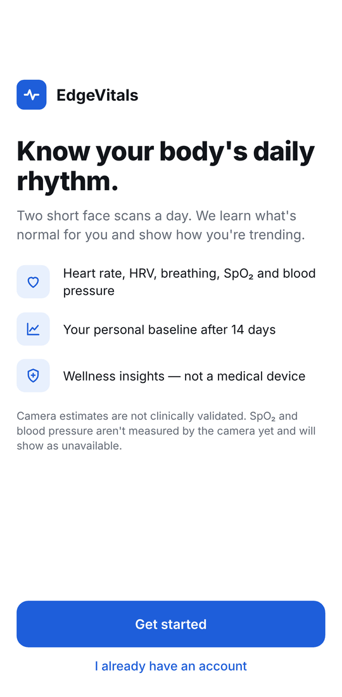</td>
    <td align="center" width="33%">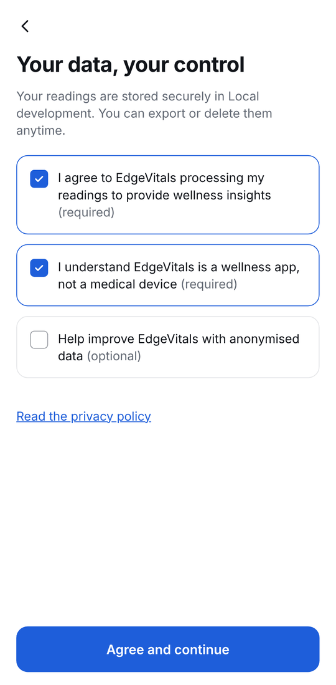</td>
    <td align="center" width="33%">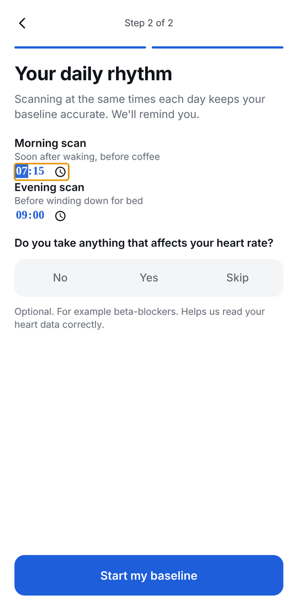</td>
  </tr>
  <tr>
    <td valign="top"><b>Welcome.</b> States up front that camera estimates are not clinically validated and that SpO₂ and blood pressure are not measured by the camera.</td>
    <td valign="top"><b>Consent.</b> Two required consents and one optional one, off by default. The hosting region comes from server config.</td>
    <td valign="top"><b>Daily rhythm.</b> Morning and evening scan times, used for reminders and to keep the baseline consistent.</td>
  </tr>
</table>

### Daily check-in and scanning

<table>
  <tr>
    <td align="center" width="33%">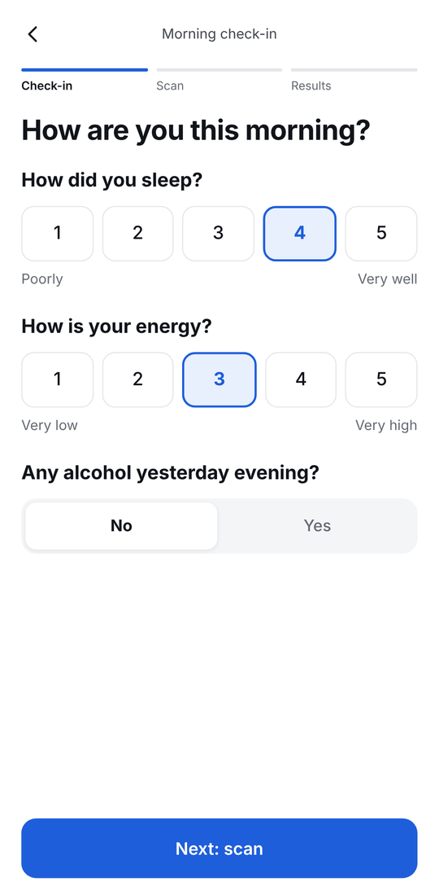</td>
    <td align="center" width="33%">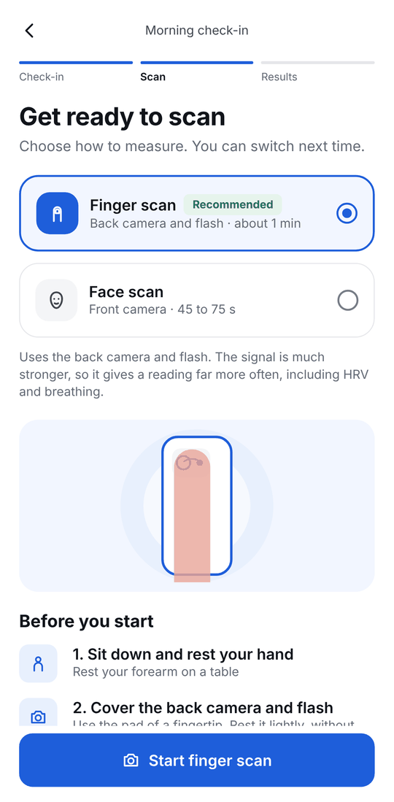</td>
    <td align="center" width="33%">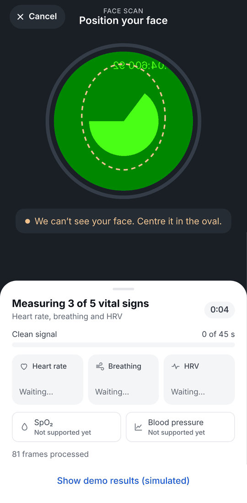</td>
  </tr>
  <tr>
    <td valign="top"><b>Check-in.</b> Sleep, energy and alcohol in the morning; stress and energy in the evening.</td>
    <td valign="top"><b>Get ready to scan.</b> Finger scan (back camera and flash, recommended) or face scan (front camera, 45 to 75 s).</td>
    <td valign="top"><b>Face scan, refusing to guess.</b> Chromium's synthetic test camera has no face, so the frame gates hold every metric at "Waiting". The suite checks that no reading is ever produced.</td>
  </tr>
</table>

### Results and transparency

<table>
  <tr>
    <td align="center" width="33%">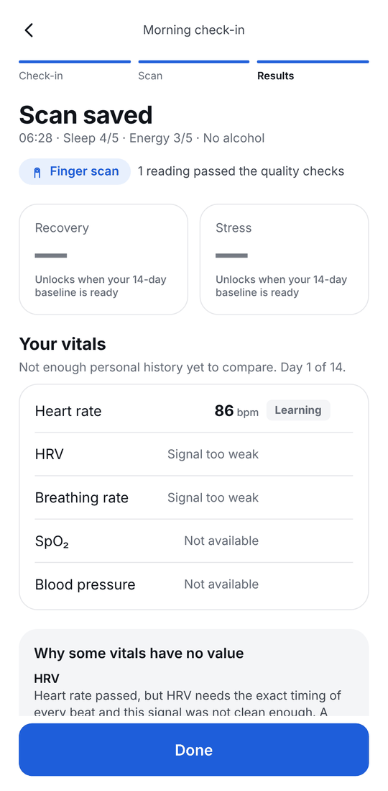</td>
    <td align="center" width="33%">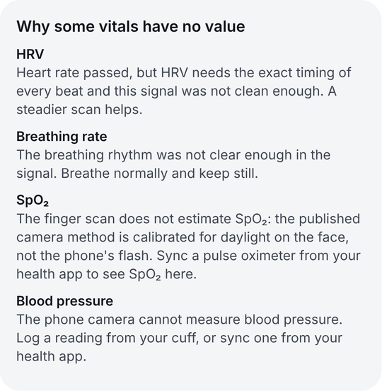</td>
    <td align="center" width="33%">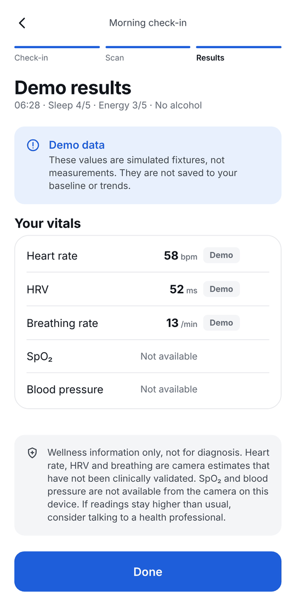</td>
  </tr>
  <tr>
    <td valign="top"><b>Partial result</b> <i>(test fixture)</i>. Heart rate passed; HRV and breathing were withheld for signal quality; SpO₂ and blood pressure are not available from this scan.</td>
    <td valign="top"><b>Why some vitals have no value.</b> Every missing metric gets a specific reason rather than an unexplained dash.</td>
    <td valign="top"><b>Demo results</b> <i>(simulated)</i>. Only when the server enables demo mode, which production refuses. Never saved to the baseline or trends.</td>
  </tr>
</table>

### Baseline, trends and insights

<table>
  <tr>
    <td align="center" width="33%">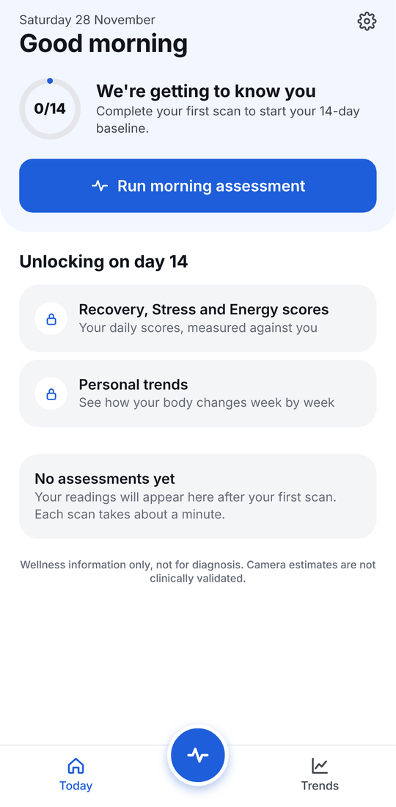</td>
    <td align="center" width="33%">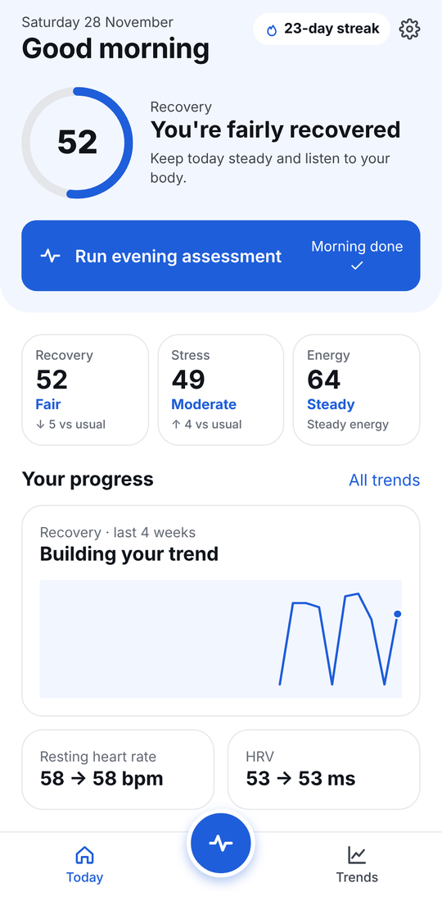</td>
    <td align="center" width="33%">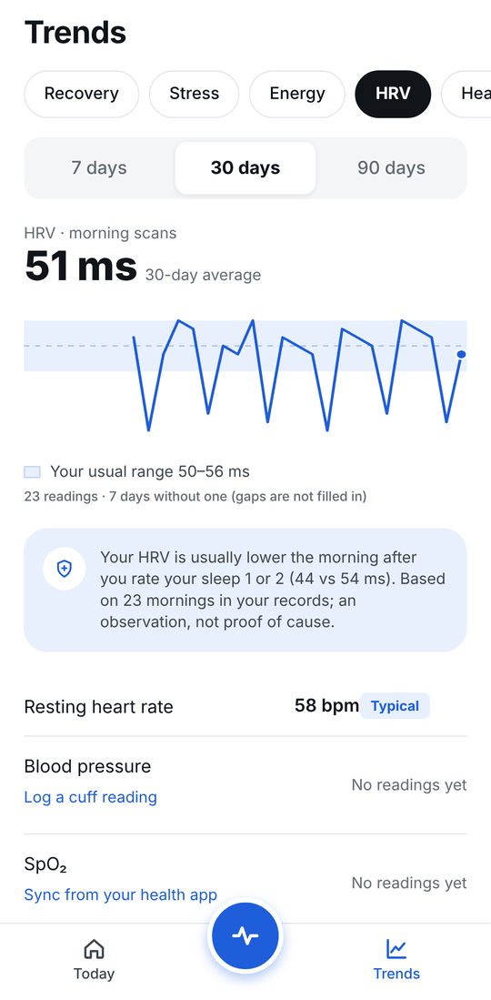</td>
  </tr>
  <tr>
    <td valign="top"><b>Day one.</b> Scores and trends stay locked until the 14-day baseline is ready.</td>
    <td valign="top"><b>Today, with history</b> <i>(test fixtures)</i>. Draft Recovery, Stress and Energy scores relative to the person's own baseline, plus a streak.</td>
    <td valign="top"><b>Trends</b> <i>(test fixtures)</i>. Morning HRV over 30 days with the personal usual range, and an insight worded as "an observation, not proof of cause".</td>
  </tr>
</table>

### Your data and other sources

<table>
  <tr>
    <td align="center" width="33%">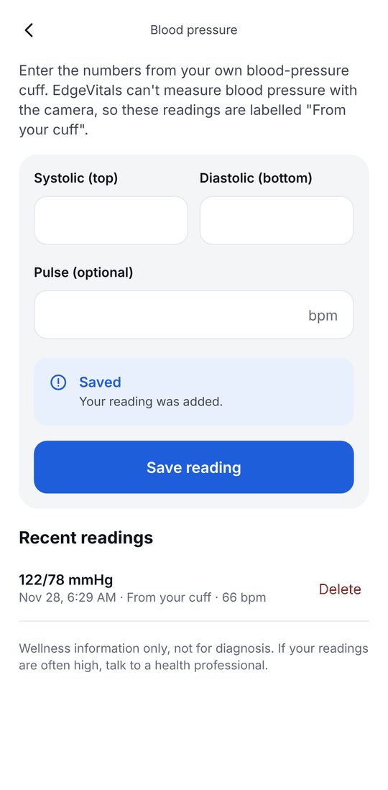</td>
    <td align="center" width="33%">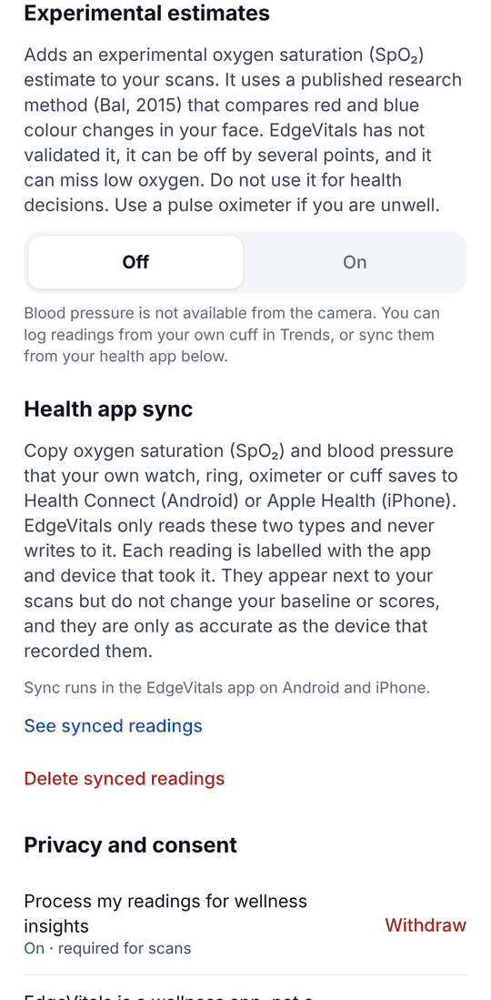</td>
    <td align="center" width="33%">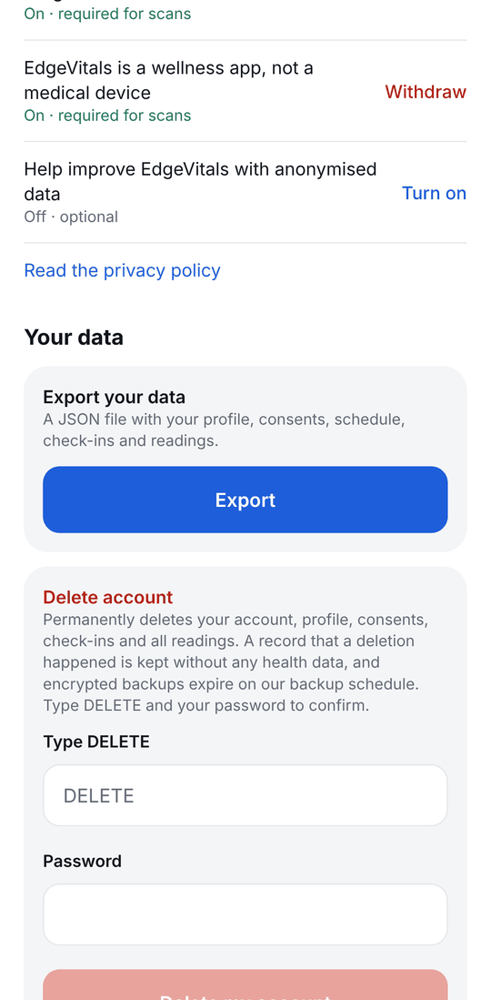</td>
  </tr>
  <tr>
    <td valign="top"><b>Cuff blood pressure.</b> Readings typed in from the person's own cuff, labelled "From your cuff". The example entry was typed by the test.</td>
    <td valign="top"><b>Experimental estimates and health app sync.</b> Camera SpO₂ is off by default; synced readings are read-only and never feed the baseline.</td>
    <td valign="top"><b>Your data.</b> Consent withdrawal, JSON export, and account deletion that requires typing DELETE and the password.</td>
  </tr>
</table>

Screenshots still to capture on a real phone are listed in [docs/images/README.md](docs/images/README.md).

## Features

### Implemented

| Area                     | What it does                                                                                                                                                                                                                                                                                                              |
| ------------------------ | ------------------------------------------------------------------------------------------------------------------------------------------------------------------------------------------------------------------------------------------------------------------------------------------------------------------------- |
| Onboarding and consent   | Welcome, consent, account, "About you" profile and daily-rhythm screens. Required and optional consents are stored separately with policy version and timestamp, and can be withdrawn in Settings.                                                                                                                        |
| Profile and schedule     | Year of birth, sex at birth, height, weight, an optional "anything that affects your heart rate?" question, and morning/evening scan times. Editable in Settings.                                                                                                                                                         |
| Morning/evening check-in | Short questionnaire (sleep, energy, alcohol, stress) before each scan.                                                                                                                                                                                                                                                    |
| Face scan (rPPG)         | Front camera. Heart rate, HRV (RMSSD) and breathing rate, each behind its own gates. 45 s of usable signal, extended up to 75 s if heart rate has not passed yet; hard stop at 90 s. Live guidance, elapsed time, pulse-signal strength after 15 s, and interim heart rate, HRV and breathing once each passes its gates. |
| Finger scan (PPG)        | Fingertip over the back camera with the flash on. Heart rate, HRV (RMSSD and SDNN) and breathing rate. 60 s target, 75 s hard stop so the flash does not overheat the phone. Shows the last 10 s of pulse waveform with detected beats.                                                                                   |
| Quality gates            | Frame-level checks (face position and size, lighting, clipping, motion) and per-metric signal checks. A metric that fails shows "No reliable reading" with a reason.                                                                                                                                                      |
| Scan details             | Per-area pulse SNR, frame statistics and the gate that failed. "Share signal trace" exports per-frame mean skin colour (no images) for offline analysis. These tester tools are currently visible in every build.                                                                                                         |
| Personal baseline        | Per metric, from morning scans only: median and robust spread (MAD) once there are 14 days and at least 7 valid samples on 5 distinct days.                                                                                                                                                                               |
| Trends and insights      | 7/30/90-day trends per metric with the usual range; deterministic insights shown only with at least 5 mornings per group and an effect size of at least 0.5; a 30-day report card that unlocks after 30 days and 20 assessed days.                                                                                        |
| Cuff blood pressure      | Manual entry of readings from the person's own cuff, validated and stored apart from camera data.                                                                                                                                                                                                                         |
| Data export and deletion | JSON export of profile, consents, schedule, check-ins and readings. Account deletion needs the word DELETE and the password. Expired export payloads are purged.                                                                                                                                                          |
| Reminders                | Local notifications (`expo-notifications`) for the next 7 days at the person's scan times, rescheduled on each visit to Today and after time-zone changes. No health data in the text. Not available on web.                                                                                                              |
| Privacy                  | On-device signal processing, no frames stored or uploaded, health-data-free logs, per-user data scoping in every query.                                                                                                                                                                                                   |

### Experimental or draft

| Area                               | Status                                                                                                                                                                                                                                           |
| ---------------------------------- | ------------------------------------------------------------------------------------------------------------------------------------------------------------------------------------------------------------------------------------------------ |
| Camera SpO₂                        | **Opt-in, off by default** (Settings → Experimental estimates). Face scan only, shown with an orange "Experimental" pill, never feeds baselines or scores. See [ADR 0008](docs/adr/0008-experimental-camera-spo2.md).                            |
| Recovery, Stress and Energy scores | Draft formulas (`scores-v0-draft`). The weights are judgement calls, not fitted or validated, and still await product approval. See [ADR 0005](docs/adr/0005-baseline-scores-insights.md).                                                       |
| Health Connect / Apple Health sync | Read-only import of SpO₂ and blood pressure, behind its own optional consent. Android not yet tested on a device; iOS code-complete but untested (HealthKit needs an Apple Developer account). See [ADR 0009](docs/adr/0009-health-app-sync.md). |
| Breathing from head movement       | Face-scan fallback when the colour-based breathing estimators abstain. See [ADR 0010](docs/adr/0010-finger-scan-and-motion-breathing.md).                                                                                                        |
| Licensed SDK for SpO₂/BP           | A provider interface exists, but no vendor is licensed, so it returns nothing. See [ADR 0007](docs/adr/0007-licensed-sdk-spo2-blood-pressure.md).                                                                                                |

### Not built

- **Camera blood pressure.** There is no published method that turns a single camera pulse signal into blood pressure with a formula that could be applied honestly, so the app shows "Not available" rather than inventing a number.
- **Password reset.** Needs an email provider; tracked as a release blocker in [production readiness](docs/production-readiness.md).

## How the measurement works

All of this lives in [`packages/measurement`](packages/measurement/src), pure TypeScript with no native dependencies, so the same code runs in the phone's frame processor, in the web build and in the unit tests. The gate thresholds are versioned (`CONFIG_VERSION = "v0.3-window-consensus"` for the face pipeline, `finger-v0.1-synthetic-defaults` for the finger pipeline) and stored with every measurement.

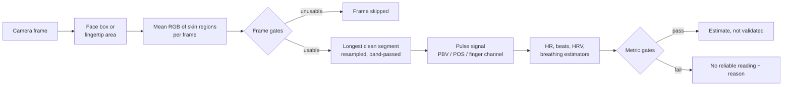

### 1. From pixels to colour averages

On a phone, VisionCamera delivers YUV frames and ML Kit finds the face on the device. For each frame, [`extractRoiYuv`](packages/measurement/src/yuv.ts) averages the skin pixels of three regions (forehead, left cheek, right cheek) and records luma, clipped-pixel share and skin-pixel count. On the web, MediaPipe's face detector does the same job. The frame is then discarded: only these few numbers per frame leave the capture code ([ADR 0003](docs/adr/0003-on-device-measurement.md)).

To keep camera behaviour from looking like a pulse, the app locks auto-exposure and white balance on the face shortly after the scan starts, holds the skin-sampling box still, and splits the signal wherever mean skin colour jumps by more than 3% between frames. A real pulse changes skin colour by well under 1%.

For the **finger scan**, the back camera and flash are used instead. Each frame is reduced to the mean colour of the central half of the image, plus checks that the lens is covered and the image is neither too dark nor saturated.

### 2. From colour to a pulse signal

The face pulse is a tiny periodic change in skin colour as blood volume changes. Two published projections separate it from lighting and motion:

- **PBV** (de Haan & van Leest, 2014) projects the colour signal onto the known blood-volume signature, weighting down the noisiest channel.
- **POS** (Wang et al., 2017) projects onto the plane orthogonal to skin tone.

The finger scan is a contact measurement with a much stronger pulse, so it uses whichever colour channel has the best pulse SNR, skipping channels that are too dark or clipped by the flash.

### 3. From pulse to metrics

| Metric         | Face scan                                                                                                                                                                                                                                                                   | Finger scan                                                                                                                                        |
| -------------- | --------------------------------------------------------------------------------------------------------------------------------------------------------------------------------------------------------------------------------------------------------------------------- | -------------------------------------------------------------------------------------------------------------------------------------------------- |
| Heart rate     | Passes either **window consensus** (10 s windows every 2 s each vote for their strongest 42–180 bpm peak; enough votes must agree within ±6 bpm) or the **whole-scan spectrum** check (POS SNR ≥ 3 dB, first and second half agree within 6 bpm, beat intervals plausible). | Best-channel spectral peak with SNR ≥ 6 dB, halves within 5 bpm, ≥ 80% of beat intervals accepted, beat HR within 4 bpm of the spectral peak.      |
| HRV            | RMSSD from detected peaks with parabolic refinement and local-median interval rejection. Needs SNR ≥ 13 dB, because timing noise inflates RMSSD.                                                                                                                            | RMSSD and SDNN from beats re-timed against the average beat shape. Also requires an estimated beat-timing error small enough not to inflate RMSSD. |
| Breathing rate | Two estimators must agree within 3 breaths/min: respiratory sinus arrhythmia in the beat intervals, and low-frequency skin intensity. If both abstain, head-movement breathing can pass on its own gates.                                                                   | Three respiratory modulations of the pulse (baseline, amplitude, interval). Two clear ones must agree within 2 breaths/min.                        |
| SpO₂           | Opt-in experimental ratio of ratios on red and blue (Bal, 2015: `SpO₂ = 101.6 − 5.834·R`), only after heart rate passes and only within 90–100%.                                                                                                                            | Not reported: the published calibration was fitted for ambient light on the face, not flash light through a finger.                                |
| Blood pressure | Not available.                                                                                                                                                                                                                                                              | Not available.                                                                                                                                     |

Full thresholds, durations and the reasoning behind each change are in [ADR 0004](docs/adr/0004-metric-availability-and-gates.md) and [ADR 0010](docs/adr/0010-finger-scan-and-motion-breathing.md), and in [`config.ts`](packages/measurement/src/config.ts) and [`finger.ts`](packages/measurement/src/finger.ts).

### Why a scan can end with no reading

A face pulse on a phone camera is often at or below the noise floor: on the development phone it sat near 0 dB SNR, and head movement, dim light or exposure changes easily swamp it. The gates are designed so that pure noise does not produce a number. In the regression tests, 0 of 150 white-noise and 0 of 120 phone-like noise captures produced a heart rate, and calibration runs outside the test suite saw 0 of 4,000 pulseless captures accepted. The cost is that real scans in poor conditions are often rejected. That is intended: "No reliable reading" is a correct answer, while a confident wrong number is not.

### Four sources, kept apart

| Source                          | Origin                                     | How it is labelled                     | Feeds baseline and scores |
| ------------------------------- | ------------------------------------------ | -------------------------------------- | ------------------------- |
| Camera estimate (face / finger) | EdgeVitals pipeline on the phone           | "Estimate, not validated"              | Yes (HR, HRV)             |
| Experimental camera SpO₂        | EdgeVitals pipeline, opt-in                | Orange "Experimental" pill             | No                        |
| Cuff blood pressure             | Typed in by the person from their own cuff | "From your cuff"                       | No                        |
| Health Connect / Apple Health   | The person's watch, ring, oximeter or cuff | "Your device" plus app and device name | No                        |

Each source has its own table and `method` value in the database, so readings can never be mixed up or silently merged. Synced and cuff readings are copied as recorded: out-of-range records are skipped and counted, never adjusted.

## Limitations and validation status

- **No clinical validation.** No metric has been compared against reference instruments (ECG, capnography, pulse oximetry) on real people. Removing the "not validated" label requires a pre-registered protocol across representative devices, skin tones and lighting, with Bland–Altman analysis ([ADR 0004](docs/adr/0004-metric-availability-and-gates.md), doc 12 §4).
- **Gates tuned on synthetic data.** Thresholds are engineering defaults from simulated signals with known ground truth, plus a handful of real signal traces from one Android phone without a reference device.
- **Limited device coverage.** Native scans have run on one Android phone. The [native camera test plan](docs/native-camera-device-tests.md) has not been completed on any device, and iOS has not been run on hardware.
- **Face scan is demanding.** It works best with the phone propped up, even front light and a still head for up to 75 s. HRV and breathing from the face rarely pass on the development phone; the finger scan is the recommended default for that reason.
- **Experimental SpO₂ is not a pulse oximeter.** An independent benchmark of the published method reports a mean error of 1.84 points overall and 4.48 points below 95% saturation; camera SpO₂ is also known to be affected by skin tone and lighting. EdgeVitals has not validated it at all, and it can miss low oxygen.
- **Draft scores.** Recovery, Stress and Energy weights are judgement calls awaiting approval.
- **Not regulatory-reviewed.** The general-wellness positioning still needs confirmation with counsel for each launch market ([production readiness](docs/production-readiness.md) §4).

## Privacy

- **On-device processing.** Camera frames are reduced to a few colour averages per frame on the phone. No frame, image or video is written to disk or uploaded. The API receives only derived results and quality metadata ([ADR 0003](docs/adr/0003-on-device-measurement.md)).
- **Consent first.** Nothing is stored before consent. Optional consents (anonymised research data, health app sync) are off by default, and the API rechecks required consents when an assessment starts and when check-ins and readings are submitted.
- **Read-only health sync.** EdgeVitals reads only SpO₂ and blood pressure from Health Connect or Apple Health and never writes to them.
- **Your data, your control.** Export as JSON; delete the account and all its data; withdraw consents; delete synced readings separately.
- **Security basics.** argon2id passwords, 15-minute access tokens with rotating refresh tokens and reuse detection, per-IP and per-account lockouts, tokens kept in the Keychain/Keystore, every query scoped by user, and logs that redact bodies and auth headers. See the [security and accessibility review](docs/security-accessibility-review.md).
- The in-app privacy policy is marked **Draft** and still needs review by privacy counsel.

## Architecture

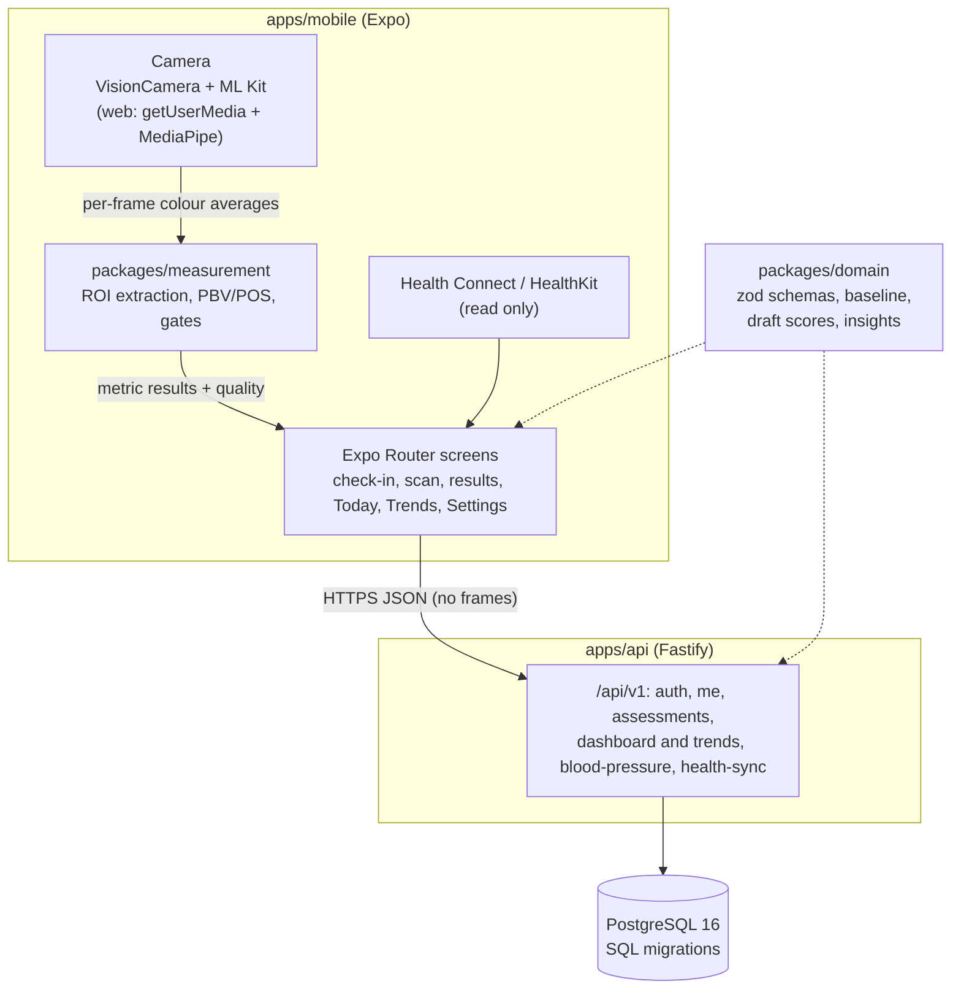

| Component                                      | Responsibility                                                                                                                                                                                                                                                 |
| ---------------------------------------------- | -------------------------------------------------------------------------------------------------------------------------------------------------------------------------------------------------------------------------------------------------------------- |
| [`packages/measurement`](packages/measurement) | Signal pipeline in pure TypeScript: YUV skin-region extraction, frame quality, PBV/POS, DSP (Butterworth filters, Welch spectra), heart-rate consensus, HRV, breathing, finger PPG, head-movement breathing, experimental SpO₂ and the licensed-SDK interface. |
| [`packages/domain`](packages/domain)           | Shared zod schemas for the API contract, plus analytics: baseline, draft scores, streaks, insights and the 30-day report.                                                                                                                                      |
| [`apps/api`](apps/api)                         | Fastify 5 API with zod validation, helmet, rate limiting, argon2id auth, consents, assessments, measurements, cuff and synced readings, dashboard/trends, export and deletion. Plain-SQL migrations in [`apps/api/migrations`](apps/api/migrations).           |
| [`apps/mobile`](apps/mobile)                   | Expo SDK 58 / React Native app with Expo Router. Native camera via VisionCamera frame processors and on-device ML Kit; the web build runs the face scan with MediaPipe. Secure token storage, local reminders, crash notes.                                    |

Decisions behind the stack are recorded in [ADR 0001](docs/adr/0001-monorepo-and-stack.md) and [ADR 0002](docs/adr/0002-authentication.md).

## Getting started

### Prerequisites

- Node.js 20 or newer (CI uses Node 22) and npm
- PostgreSQL 16 for the API and its tests
- For phone builds: an Expo account (cloud builds), or Xcode / Android Studio (local builds)

### Install

```sh
npm ci
```

### Database

Create a role and two databases, one for development and one for the API tests. The test suite also creates temporary databases, so the role needs `CREATEDB`:

```sh
sudo -u postgres psql -c "CREATE ROLE edgevitals LOGIN PASSWORD 'edgevitals' CREATEDB"
sudo -u postgres createdb -O edgevitals edgevitals_dev
sudo -u postgres createdb -O edgevitals edgevitals_test
```

### Configure the API

```sh
cp apps/api/.env.example apps/api/.env
```

Set `JWT_SECRET` to at least 32 random characters (for example `openssl rand -base64 48`). The other variables are documented in [`apps/api/.env.example`](apps/api/.env.example) and [docs/deployment.md](docs/deployment.md#1-environment-variables). `.env` files are gitignored.

The API reads its settings from the environment and does not load `.env` by itself, so export the file in the shell you use for the API:

```sh
set -a; . apps/api/.env; set +a
```

### Run the API

Apply migrations:

```sh
npm run migrate -w @edgevitals/api
```

Start the server with reload on change (port 4000):

```sh
npm run dev -w @edgevitals/api
```

Check it is up:

```sh
curl http://localhost:4000/ready
```

Migrations also run automatically on start when `MIGRATE_ON_START=true` (the default).

### Run the app on the web

```sh
cd apps/mobile
cp .env.example .env
npm run web
```

`EXPO_PUBLIC_API_URL` in `apps/mobile/.env` points the app at the API (default `http://localhost:4000`). It is compiled into the bundle and is public, so never put a secret in any `EXPO_PUBLIC_*` value. The web build supports the face scan but not the finger scan, reminders or health sync.

To try the full flow without a camera, start the API with `DEMO_MODE_ENABLED=true` (local only; production refuses it). Demo results are labelled simulated and never reach the baseline or trends.

### Run the app on a phone

The native camera needs a development build; Expo Go does not include VisionCamera.

```sh
cd apps/mobile
npx expo run:android
```

```sh
cd apps/mobile
npx expo run:ios --device
```

Cloud builds for testers run from GitHub: **Actions → Build test app** (Expo EAS, needs the `EXPO_TOKEN` secret and a reachable HTTPS API). Setup, install and on-device checks are in [docs/native-camera-device-tests.md](docs/native-camera-device-tests.md).

## Testing

Type-check every workspace:

```sh
npm run typecheck
```

Run the unit and API tests (the API tests need PostgreSQL and use `DATABASE_URL`, defaulting to the local `edgevitals_test` database):

```sh
npm test
```

Check formatting:

```sh
npm run format:check
```

| Suite                                                    | Covers                                                                                                                                                  |
| -------------------------------------------------------- | ------------------------------------------------------------------------------------------------------------------------------------------------------- |
| [`packages/measurement/test`](packages/measurement/test) | DSP, ROI and YUV handling, frame gates, HR consensus, false-acceptance on simulated noise, finger PPG, head-movement breathing, experimental SpO₂       |
| [`packages/domain/test`](packages/domain/test)           | Schemas, baseline, scores, insights and report rules                                                                                                    |
| [`apps/api/test`](apps/api/test)                         | Auth, consents, assessments, hardening, export and deletion, cuff and synced readings, migration safety, deploy probes, Render Blueprint                |
| [`apps/mobile/test`](apps/mobile/test)                   | Submission mapping, missing-vital reasons, reminders, release config, health sync, timestamps                                                           |
| [`apps/mobile/e2e`](apps/mobile/e2e)                     | Playwright against the exported web build: onboarding, scans that must not produce readings, demo labelling, history, account, accessibility (axe-core) |

The end-to-end suite needs the API running in demo mode and a static web build. Step-by-step commands are in [apps/mobile/e2e/README.md](apps/mobile/e2e/README.md).

The synthetic tests are **regression guards, not validation**: they check that the code behaves as designed on simulated signals, not that it is accurate on people.

CI ([`.github/workflows/ci.yml`](.github/workflows/ci.yml)) runs formatting, type checks and tests against PostgreSQL 16, builds and smoke-tests both Docker images, runs the e2e suite under the production Content-Security-Policy, and runs `npm audit` and gitleaks.

## Deployment

| Piece         | Artifact                                                    | Notes                                                                   |
| ------------- | ----------------------------------------------------------- | ----------------------------------------------------------------------- |
| API           | [`apps/api/Dockerfile`](apps/api/Dockerfile)                | Container on port 4000, `/health` and `/ready` probes, runs as non-root |
| Web app       | [`apps/mobile/Dockerfile.web`](apps/mobile/Dockerfile.web)  | Static Expo export behind unprivileged nginx with a strict CSP          |
| Database      | PostgreSQL 16                                               | Forward-only SQL migrations, checked for backward compatibility in CI   |
| iOS / Android | EAS builds ([`apps/mobile/eas.json`](apps/mobile/eas.json)) | Store accounts not set up yet                                           |

- **Local production-like stack:** [`docker-compose.yml`](docker-compose.yml) runs Postgres, a one-off migration job, the API and the web app from `deploy.env` (copy [`deploy.env.example`](deploy.env.example)).
- **Staging:** [`render.yaml`](render.yaml) is a free-tier Render Blueprint (API + Postgres in Singapore). It is for test data only: the free database expires every 30 days and has no backups. See [docs/render-staging.md](docs/render-staging.md).
- **Production:** not set up. Hosting budget, store accounts, a public privacy policy, a support contact and a password-reset email provider are open decisions listed in [docs/production-readiness.md](docs/production-readiness.md).

Environment variables, migrations, hosting headers and the launch checklist: [docs/deployment.md](docs/deployment.md).

## Documentation

| Topic                             | Document                                                                                                                   |
| --------------------------------- | -------------------------------------------------------------------------------------------------------------------------- |
| Product specification             | [docs/spec/](docs/spec) (requirements, UX spec, functional spec, data model, API contract, measurement pipeline, and more) |
| Product requirements              | [01_PRODUCT_REQUIREMENTS.md](docs/spec/01_PRODUCT_REQUIREMENTS.md)                                                         |
| Measurement pipeline spec         | [08_MEASUREMENT_PIPELINE.md](docs/spec/08_MEASUREMENT_PIPELINE.md)                                                         |
| Baseline and analytics            | [09_BASELINE_AND_ANALYTICS.md](docs/spec/09_BASELINE_AND_ANALYTICS.md)                                                     |
| Security and privacy spec         | [11_SECURITY_PRIVACY.md](docs/spec/11_SECURITY_PRIVACY.md)                                                                 |
| Testing and validation            | [12_TESTING_VALIDATION.md](docs/spec/12_TESTING_VALIDATION.md)                                                             |
| Wireframes (reference)            | [EdgeVitals-POC-Wireframes.pdf](docs/spec/EdgeVitals-POC-Wireframes.pdf)                                                   |
| Architecture decisions            | [docs/adr/](docs/adr/README.md)                                                                                            |
| Design deviations                 | [docs/design-deviations.md](docs/design-deviations.md): where and why the app differs from the wireframes                  |
| Production readiness              | [docs/production-readiness.md](docs/production-readiness.md)                                                               |
| Deployment                        | [docs/deployment.md](docs/deployment.md)                                                                                   |
| Staging (Render)                  | [docs/render-staging.md](docs/render-staging.md)                                                                           |
| Native device testing             | [docs/native-camera-device-tests.md](docs/native-camera-device-tests.md)                                                   |
| End-to-end tests                  | [apps/mobile/e2e/README.md](apps/mobile/e2e/README.md)                                                                     |
| Security and accessibility review | [docs/security-accessibility-review.md](docs/security-accessibility-review.md)                                             |
| Third-party notices               | [THIRD_PARTY_NOTICES.md](THIRD_PARTY_NOTICES.md)                                                                           |

## Roadmap

Open work, taken from [docs/production-readiness.md](docs/production-readiness.md):

- **Device testing:** complete the native camera test plan on a recent iPhone and Android phone, plus VoiceOver/TalkBack passes.
- **Measurement validation:** a study against reference devices before any accuracy claim.
- **Release blockers:** password reset (needs an email provider), production hosting with backups, store accounts, a reviewed public privacy policy and the regulatory position.
- **Engineering:** hide tester-only tools (scan details, signal trace) in production builds; add ESLint and a licence inventory check to CI; performance baselines on the test phone.
- **Product decisions:** approve or revise the draft Recovery, Stress and Energy formulas.
